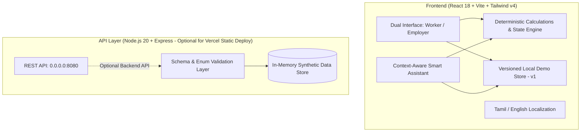

# FairShift 2026

> Transparent Shifts, Fair Pay & Worker Safety for Frontline Construction and College Support Services.
> Built for Hackathon SDG 8 (Decent Work and Economic Growth).

[](#automated-testing)
[](#1-chosen-challenge-vertical--sdg-8-problem-statement)
[](#5-fairshift-context-aware-smart-assistant)
[](#9-deploying-to-vercel--running-locally)

---

## 1. Chosen Challenge Vertical & SDG 8 Problem Statement

**Sustainable Development Goal 8 (Decent Work and Economic Growth)** calls for safe, secure working environments and transparent, fair compensation for all workers (Target 8.5 & 8.8).

Frontline, hourly, and informal workers in physically demanding sectors face acute vulnerabilities:
- **Opacity in Shift Records & Overtime**: In informal or sub-contracted operations, hours worked beyond standard shift limits are routinely undercounted or arbitrarily rounded down. Frontline workers lack accessible, transparent itemization of how overtime multipliers are calculated.
- **Excessive Fatigue & Hazardous Rest Deficits**: Back-to-back shifts with insufficient rest intervals (<11 hours) lead to acute exhaustion, dramatically escalating workplace accident risks.
- **Barriers to Reporting Hazards**: Frontline workers hesitate to report physical hazards or wage discrepancies due to fear of informal retaliation or lack of tracking.

**FairShift** bridges this transparency gap with an accessible, mobile-first progressive platform backed by deterministic calculation models, rule-based fatigue alerts, supervisor-accountable safety tracking, and an embedded context-aware assistant.

---

## 2. Two Fictional Industry Use Cases

FairShift focuses specifically on two high-risk, labor-intensive environments using locally grounded synthetic profiles with Indian Rupee (₹) pricing:

### Industry 1: Metro Rail & Civil Construction (`BuildRight Infrastructure Ltd`)
- **Operational Reality**: High-intensity civil construction site (metro underground stations, viaducts, continuous concrete pours).
- **Frontline Roles**: Rebar & Scaffold Lead (Muthu Velan), Concrete Pouring Technician (Ramesh Kumar), Crane Signal Spotter (Priya Sundaram).
- **Key Challenges Demonstrated**: Continuous 11-hour shifts with emergency de-shuttering causing critical rest deficits (<10.5h gap between shifts); dropped-tool fall hazards from 3rd-tier scaffolding lacking toe-boards; hydraulic oil leakage around batching transit mixers.

### Industry 2: College Housekeeping & Support Services (`Apex Heights College Facilities`)
- **Operational Reality**: Campus facilities management encompassing science laboratories, student residences, and dining commons.
- **Frontline Roles**: Senior Sanitation Attendant (Anandhi Raman), Hostel & Lab Maintenance Staff (Murugan Selvam).
- **Key Challenges Demonstrated**: Chemical exposure hazards from broken ventilation in chemical dilution supply rooms; customized 7.5-hour standard shift thresholds with distinct institutional overtime rules.

---

## 3. Personas

| Persona | Role | Key Objectives & Pain Points |
| :--- | :--- | :--- |
| **Muthu Velan** | Rebar Lead (Worker) | Wants clear proof of worked hours and calculated overtime (₹130/hr base + 1.5x OT); needs visibility into whether rest gaps between shifts violate health guidelines; needs to know if supervisors have repaired scaffold fall hazards. |
| **Anandhi Raman** | Sanitation Staff (Worker) | Requires bilingual (Tamil/English) mobile interface; needs to track supervisor work orders on hazardous chemical exhaust fumes in campus dilution closets without fear of dismissal. |
| **Site Operations Director** | Employer / Supervisor | Monitors workforce fatigue risk across all registered personnel; ensures standard daily shifts and minimum rest periods are respected; resolves worker-submitted grievances with formal documented follow-up notes. |

---

## 4. FairShift Approach & Solution Logic

FairShift replaces opaque paper logs and arbitrary supervisor estimates with explicit, deterministic logic:
1. **Mathematical Determinism**: Pay calculations separate regular hours from overtime hours using configurable organization policies (e.g., 8.0h threshold in construction, 7.5h in campus services; 1.5x wage multiplier).
2. **Rule-Based Fatigue Monitoring**: Rather than using black-box, unvalidated AI predictions, FairShift checks three deterministic thresholds:
   - **Daily Duty Limit**: Shift duration $> \text{Max Daily Threshold}$ (e.g., $>10\text{h}$).
   - **Mandatory Rest Interval**: Gap between the end of shift $i$ and start of shift $i+1 < \text{Min Rest Threshold}$ (e.g., $<11\text{h}$).
   - **Rolling 7-Day Total**: Aggregate hours over the past 7 days $> \text{Max Weekly Cap}$ (e.g., $>48\text{h}$).
3. **Supervisor Accountability Loop**: State changes made by employers (`OPEN` $\to$ `IN_REVIEW` $\to$ `RESOLVED`) and resolution notes are reflected instantaneously in the worker's experience.

---

## 5. FairShift Context-Aware Smart Assistant

To meet the evaluation criteria for a smart, dynamic assistant without introducing unpredictable hallucinations or expensive cloud dependencies, FairShift features a **Deterministic Context-Aware Assistant** (`shared/assistant.js`).

### How It Works:
- **Zero Hallucination / Grounded Execution**: The assistant does not invent numbers or claim legal authority. It queries the actual state of the application: active worker, organization settings, completed shifts, fatigue alerts, and submitted grievance records.
- **Context Isolation**: History is strictly keyed by `role_lang_orgId_workerId`. When the user switches worker, organization, role, or language, previous conversations are isolated so messages from one context are never presented as answers for another.
- **Role & Persona Sensitivity**:
  - **Worker View**: Focuses on individual net earnings, itemized overtime math, personal fatigue evaluation, safety report statuses, and guidance on reporting hazards.
  - **Employer View**: Focuses on organization-wide fatigue alerts, unresolved critical safety hazards, aggregate labor costs, and rule threshold reviews.
- **Bilingual & Low-Literacy Support**: Provides one-click suggested question pills in both **English** and **Tamil (`தமிழ்`)**, enabling frontline workers to receive instant, structured answers with zero typing.
- **Honest Fallback**: Questions outside verifiable data receive a clear, honest disclaimer explaining what data is available.

---

## 6. Architecture & Technology Stack



- **Frontend**: React 18, Vite, Tailwind CSS v4 compiled build. **Runs 100% client-side via `shared/storage.js` for instant Vercel static deployment.**
- **Demo Data Layer (`shared/storage.js`)**: Reliable, versioned browser-local storage with recovery safeguards against corrupted JSON, maintaining shift check-ins, check-outs, and grievance resolution across page reloads. Includes an explicit **Reset Demo Data** control.
- **Backend**: Lightweight Node.js/Express REST server listening on `0.0.0.0` and dynamic `PORT` (remains in repository for container/Cloud Run environments).

---

## 7. Key Working Features

1. **Shift Check In & Check Out**: Live elapsed timer and real-time counter displaying estimated earnings and overtime activation.
2. **Shift History & Pay Breakdown**: Itemizes regular hours, overtime hours, base hourly pay, overtime rate, and total estimated earnings with Indian Rupee (₹) currency formatting.
3. **Safety & Grievance Reporting**: Category and severity selection (Low to Critical Risk), account-linked tracking, and real-time status progression.
4. **Employer Operations Dashboard**: Aggregated metrics on active workforce, duty hours, overtime ratios, and pending safety concerns.
5. **Rule-Based Fatigue Monitor**: Alerts supervisors with specific reasons in English or Tamil (excessive daily shift or short recovery rest gap) and calculates 7-day rolling totals.
6. **Bilingual Toggle**: Seamless switching between English and native Tamil (`தமிழ்`) with zero placeholder text.

---

## 8. Automated Testing & Verification

Run the comprehensive test suite (40 automated tests passing):

```bash
npm test
```

### Verified Test Breakdown:
- **Browser Smoke Lifecycle Tests (`test/browser_smoke.test.js`)**:
  - Full check-in, page refresh simulation, active shift retention.
  - Check-out and itemized earnings calculation.
  - Grievance submission and persistence across browser refresh.
  - Employer grievance resolution and worker resolution reflection.
  - Multi-worker, multi-org, and bilingual assistant context isolation.
  - One-click demo data reset restoring pristine initial state.
- **Assistant Tests (`test/assistant.test.js` & `test/assistant_isolation.test.js`)**:
  - Dynamic earnings calculations matching selected worker.
  - Fatigue warning identification for fatigued workers.
  - Native Tamil assistant responses.
  - Employer unresolved critical hazard identification.
  - Real-time assistant response updates when report status changes.
  - Cross-industry threshold differentiation (Construction vs College).
  - Non-hallucinatory fallback handling for out-of-scope queries.
  - Clean conversation isolation between different workers.
  - Role-appropriate intent isolation between worker and employer.
  - Bilingual intent accuracy.
- **Storage & State Tests (`test/storage.test.js`)**:
  - Versioned initialization with schema tagging (`_version: 1`).
  - Corrupted JSON recovery falling back safely to verified seed fixtures.
  - Version mismatch auto-migration.
  - End-to-end check-in and check-out state persistence and earnings recalculation.
  - Safety report submission and supervisor status resolution persistence.
  - One-click demo data reset restoring pristine dataset.
- **Calculations Tests (`test/calculations.test.js`)**:
  - `calculateDurationHours`: Verified decimal hours and inverted timestamp rejection.
  - `calculateShiftEarnings`: Verified regular and overtime pay calculations.
  - `evaluateFatigueRisk`: Verified daily limit and insufficient rest interval detection.
  - Data partitioning between organizations.
- **Server API Lifecycle Tests (`test/server_api.test.js`)**:
  - `GET /api/health`: Healthcheck, version, and synthetic data disclosure.
  - `GET /api/org/:id/data`: Scoped retrieval verifying data isolation.
  - `POST /api/shifts/check-in`: Rejection of cross-org worker mismatches.
  - `POST /api/reports`: Schema validation and initial `OPEN` state.
  - `PATCH /api/reports/:id`: Status transitions and supervisor notes.
  - `POST /api/shifts/check-out`: Full calculation cycle.

---

## 9. Deploying to Vercel & Running Locally

### Deploying to Vercel (Instant Zero-Config Static Vite Deployment)
FairShift is fully self-contained and pre-configured for Vercel:
- **Framework Preset**: `Vite`
- **Build Command**: `npm run build`
- **Output Directory**: `dist`
- **Install Command**: `npm install`
- *No environment variables or external backend server required.*

### Running Locally
1. **Clone the repository**:
   ```bash
   git clone https://github.com/RoshwinNiketh/fairshift.git
   cd fairshift
   ```
2. **Install dependencies**:
   ```bash
   npm install
   ```
3. **Build the production frontend**:
   ```bash
   npm run build
   ```
4. **Preview locally**:
   ```bash
   npm run preview
   ```
   Or run the full-stack server:
   ```bash
   npm start
   ```
   Open `http://localhost:8080` or `http://localhost:4173`.

---

## 10. Accessibility & Inclusivity (UI/UX Pro Max Audited)

- **Semantic HTML**: Semantic elements (`<main>`, `<section>`, `<header>`, `<footer>`, `<dialog>`) with appropriate ARIA roles (`role="alert"`, `aria-expanded`, `aria-controls`, `aria-label`).
- **Touch Target Ergonomics**: Primary action buttons exceed the minimum 48px/44px threshold (Check In/Out: 56px; submit buttons: 46px; selectors: 38px) with 8px+ spacing.
- **Accessible Form Controls**: All form inputs and dropdowns use explicit matching `htmlFor` and `id` attributes.
- **Viewport Scalability**: Full pinch-to-zoom allowed (`user-scalable=yes`) for workers on mobile devices.
- **High-Contrast Focus Indicators**: Visible keyboard focus states (`outline: 2px solid #22c55e`).
- **Device Independence**: Fully functional without requiring camera, GPS, or microphone hardware permissions.

---

## 11. Assumptions, Limitations & Disclaimers

1. **Synthetic Data Disclosure**: All organizations, worker names, phone numbers, and logged incidents are fictional synthetic fixtures created exclusively for hackathon evaluation.
2. **Browser-Local Persistence**: Interactive modifications are saved in the browser's localStorage (`fairshift_demo_state_v1`). Users can reset state at any time using the "Reset Demo Data" button. Multi-device real-time sync is not present.
3. **Non-Payroll Compliance Disclaimer**: FairShift provides estimated calculations for workplace transparency and personal verification. It does not constitute official legal payroll compliance, binding tax calculations, or statutory wage slips.
4. **Account-Linked vs Anonymous Reporting**: Reports are account-linked so supervisors can be held accountable for resolving them; true anonymous reporting without worker identity is intentionally not claimed.
5. **Demonstration Role Selector**: The UI role selector is provided for judging convenience and does not enforce cryptographic multi-tenant RBAC or production authentication.
